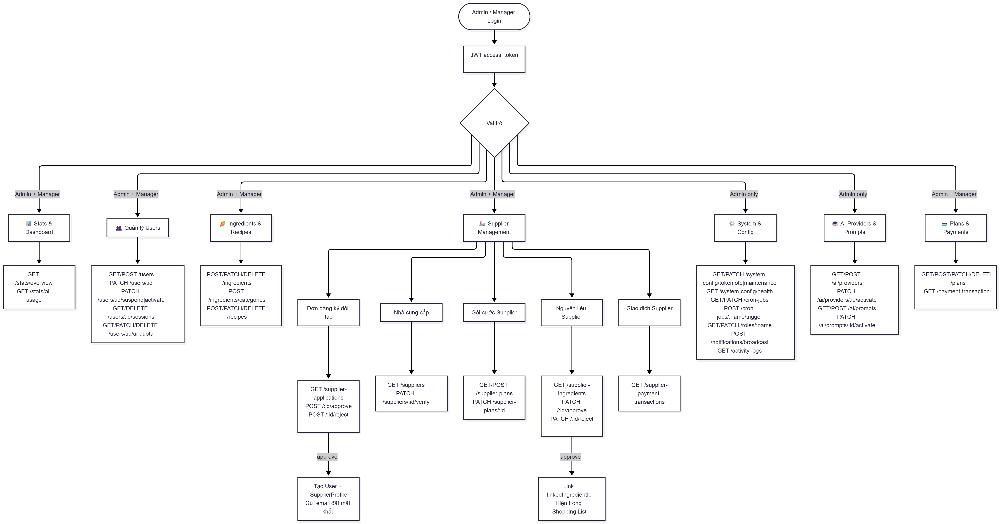

# Friggy — Admin API Guide

> Base URL: `/api/v1`  
> Tất cả endpoint yêu cầu `Authorization: Bearer <access_token>`  
> **Chú thích quyền:** `[Admin]` = chỉ role `admin` | `[Admin | Manager]` = cả hai role

---

## Tổng quan luồng Admin



---

## Mục lục

1. [Stats — Thống kê tổng quan](#1-stats--thống-kê-tổng-quan)
2. [Users — Quản lý người dùng](#2-users--quản-lý-người-dùng)
3. [Sessions & AI Quota](#3-sessions--ai-quota)
4. [Roles — Vai trò](#4-roles--vai-trò)
5. [Subscription Plans (User)](#5-subscription-plans-user)
6. [Payment Transactions (User)](#6-payment-transactions-user)
7. [Ingredients & Categories](#7-ingredients--categories)
8. [Recipes — Công thức](#8-recipes--công-thức)
9. [Supplier Applications — Đơn đăng ký đối tác](#9-supplier-applications--đơn-đăng-ký-đối-tác)
10. [Suppliers — Nhà cung cấp](#10-suppliers--nhà-cung-cấp)
11. [Supplier Plans — Gói cước Supplier](#11-supplier-plans--gói-cước-supplier)
12. [Supplier Ingredients — Nguyên liệu Supplier](#12-supplier-ingredients--nguyên-liệu-supplier)
13. [Supplier Payment Transactions](#13-supplier-payment-transactions)
14. [AI — Provider & System Prompt](#14-ai--provider--system-prompt)
15. [Cron Jobs](#15-cron-jobs)
16. [System Config](#16-system-config)
17. [Broadcast — Gửi thông báo hàng loạt](#17-broadcast--gửi-thông-báo-hàng-loạt)
18. [Activity Logs — Nhật ký thao tác](#18-activity-logs--nhật-ký-thao-tác)

---

## 1. Stats — Thống kê tổng quan

> `[Admin | Manager]` — prefix: `/admin/stats`

| Method | Endpoint | Mô tả |
|--------|----------|-------|
| `GET` | `/admin/stats/overview` | Tổng quan: user, supplier, doanh thu gộp |
| `GET` | `/admin/stats/ai-usage?days=7` | AI usage breakdown theo featureType (default 7 ngày) |
| `GET` | `/admin/stats/subscriptions` | Phân bố subscription plans (user) |

### Response `/admin/stats/overview`

```json
{
  "users": {
    "total": 1200,
    "active": 1100,
    "suspended": 50,
    "newThisMonth": 80,
    "activeSubscriptions": 350,
    "revenueThisMonthVnd": 5800000,
    "totalRevenueVnd": 48000000
  },
  "suppliers": {
    "total": 30,
    "verified": 20,
    "activeSubscriptions": 18,
    "pendingApplications": 5,
    "pendingIngredients": 12,
    "revenueThisMonthVnd": 1200000,
    "totalRevenueVnd": 9600000
  },
  "combined": {
    "revenueThisMonthVnd": 7000000,
    "totalRevenueVnd": 57600000
  }
}
```

> [!NOTE]
> `users.total` không bao gồm tài khoản supplier. `combined` là tổng doanh thu từ cả 2 nguồn (user subscription + supplier plan).

---

## 2. Users — Quản lý người dùng

> prefix: `/admin/users`

| Method | Endpoint | Quyền | Mô tả |
|--------|----------|-------|-------|
| `GET` | `/admin/users` | Admin \| Manager | Danh sách users, hỗ trợ filter + phân trang |
| `GET` | `/admin/users/:id` | Admin \| Manager | Chi tiết user kèm profile, subscription, AI usage |
| `POST` | `/admin/users` | **Admin** | Tạo user mới với role chỉ định (tự gán gói Free) |
| `PATCH` | `/admin/users/:id` | Admin \| Manager | Cập nhật name, role, status _(Manager không được đụng Admin)_ |
| `PATCH` | `/admin/users/:id/suspend` | Admin \| Manager | Khóa tài khoản |
| `PATCH` | `/admin/users/:id/activate` | Admin \| Manager | Mở khóa tài khoản |

> [!NOTE]
> Admin/Manager không thể tự sửa tài khoản của chính mình. Manager không thể gán hoặc chỉnh sửa tài khoản có role `admin`.

---

## 3. Sessions & AI Quota

> `[Admin]` — prefix: `/admin/users/:id`

### Sessions

| Method | Endpoint | Mô tả |
|--------|----------|-------|
| `GET` | `/admin/users/:id/sessions` | Xem tất cả phiên đăng nhập đang hoạt động |
| `DELETE` | `/admin/users/:id/sessions` | Thu hồi toàn bộ phiên (kick user khỏi mọi thiết bị) |
| `DELETE` | `/admin/users/:id/sessions/:sessionId` | Thu hồi 1 phiên cụ thể |
| `DELETE` | `/admin/sessions/expired` | Dọn dẹp refresh token hết hạn trên toàn DB |

### AI Quota

| Method | Endpoint | Mô tả |
|--------|----------|-------|
| `GET` | `/admin/users/:id/ai-quota` | Xem quota AI và lượt đã dùng tuần này |
| `PATCH` | `/admin/users/:id/ai-quota` | Ghi đè quota (tặng thêm hoặc khóa về 0); truyền `null` để reset về mặc định của plan |
| `DELETE` | `/admin/users/:id/ai-quota/reset` | Reset override + xóa log AI trong tuần hiện tại |

---

## 4. Roles — Vai trò

> `[Admin]` — prefix: `/admin/roles`

| Method | Endpoint | Mô tả |
|--------|----------|-------|
| `GET` | `/admin/roles` | Danh sách tất cả role kèm số user đang dùng |
| `PATCH` | `/admin/roles/:name` | Cập nhật `name` và/hoặc `description` của role |

**Body PATCH** (tất cả optional, chỉ gửi field cần thay):
```json
{ "name": "moderator", "description": "Kiểm duyệt nội dung" }
```

> [!IMPORTANT]
> Đổi `name` tự kiểm tra trùng lặp — trả 409 nếu tên mới đã tồn tại.

---

## 5. Subscription Plans (User)

> prefix: `/admin/plans`

| Method | Endpoint | Quyền | Mô tả |
|--------|----------|-------|-------|
| `GET` | `/admin/plans` | Admin \| Manager | Danh sách tất cả gói dịch vụ |
| `POST` | `/admin/plans` | **Admin** | Tạo gói dịch vụ mới |
| `PATCH` | `/admin/plans/:id` | **Admin** | Cập nhật giá, rate limit, tên, tính năng |
| `DELETE` | `/admin/plans/:id` | **Admin** | Xóa gói (soft delete) |

---

## 6. Payment Transactions (User)

> `[Admin | Manager]` — prefix: `/admin/payment-transactions`

| Method | Endpoint | Mô tả |
|--------|----------|-------|
| `GET` | `/admin/payment-transactions` | Toàn bộ lịch sử giao dịch thanh toán user |

**Query params:** `userId`, `status` (`pending` \| `paid` \| `expired` \| `cancelled`)

---

## 7. Ingredients & Categories

> `[Admin | Manager]` — prefix: `/admin/ingredients`

### Danh mục (Categories)

| Method | Endpoint | Mô tả |
|--------|----------|-------|
| `POST` | `/admin/ingredients/categories` | Tạo danh mục nguyên liệu mới |
| `PATCH` | `/admin/ingredients/categories/:id` | Cập nhật tên, `defaultShelfLifeDays`, ... |
| `POST` | `/admin/ingredients/categories/:id/icon` | Upload icon danh mục (`multipart/form-data`, JPEG/PNG/WEBP ≤ 2MB) |
| `DELETE` | `/admin/ingredients/categories/:id` | Xóa danh mục (soft delete, chặn nếu còn nguyên liệu con) |

### Nguyên liệu (Ingredients)

| Method | Endpoint | Mô tả |
|--------|----------|-------|
| `POST` | `/admin/ingredients` | Tạo nguyên liệu mới |
| `PATCH` | `/admin/ingredients/:id` | Cập nhật nguyên liệu |
| `POST` | `/admin/ingredients/:id/image` | Upload ảnh nguyên liệu (`multipart/form-data`, JPEG/PNG/WEBP ≤ 5MB) |
| `DELETE` | `/admin/ingredients/:id` | Xóa nguyên liệu (soft delete) |

---

## 8. Recipes — Công thức

> `[Admin | Manager]` — prefix: `/admin/recipes`

| Method | Endpoint | Mô tả |
|--------|----------|-------|
| `POST` | `/admin/recipes` | Tạo công thức mới (kèm ingredients + steps + tags) |
| `PATCH` | `/admin/recipes/:id` | Cập nhật thông tin công thức |
| `DELETE` | `/admin/recipes/:id` | Xóa công thức (soft delete) |

---

## 9. Supplier Applications — Đơn đăng ký đối tác

> prefix: `/admin/supplier-applications`

| Method | Endpoint | Quyền | Mô tả |
|--------|----------|-------|-------|
| `GET` | `/admin/supplier-applications` | Admin \| Manager | Danh sách đơn đăng ký (filter: status, ...) |
| `GET` | `/admin/supplier-applications/:id` | Admin \| Manager | Chi tiết 1 đơn đăng ký |
| `POST` | `/admin/supplier-applications/:id/approve` | **Admin** | Duyệt đơn — tạo tài khoản User + SupplierProfile, gửi email đặt mật khẩu |
| `POST` | `/admin/supplier-applications/:id/reject` | Admin \| Manager | Từ chối đơn — gửi email kèm lý do |

---

## 10. Suppliers — Nhà cung cấp

> `[Admin | Manager]` — prefix: `/admin/suppliers`

| Method | Endpoint | Mô tả |
|--------|----------|-------|
| `GET` | `/admin/suppliers` | Danh sách nhà cung cấp (filter: `isVerified`, ...) |
| `GET` | `/admin/suppliers/:id` | Chi tiết nhà cung cấp |
| `PATCH` | `/admin/suppliers/:id/verify` | Xác minh / thu hồi xác minh (`isVerified: true/false`) |

---

## 11. Supplier Plans — Gói cước Supplier

> `[Admin]` — prefix: `/admin/supplier-plans`

| Method | Endpoint | Mô tả |
|--------|----------|-------|
| `GET` | `/admin/supplier-plans` | Danh sách gói cước supplier |
| `POST` | `/admin/supplier-plans` | Tạo gói cước mới |
| `PATCH` | `/admin/supplier-plans/:id` | Cập nhật gói cước (giá, thời hạn, ...) |

---

## 12. Supplier Ingredients — Nguyên liệu Supplier

> `[Admin | Manager]` — prefix: `/admin/supplier-ingredients`

| Method | Endpoint | Mô tả |
|--------|----------|-------|
| `GET` | `/admin/supplier-ingredients` | Danh sách nguyên liệu supplier (filter: `status`, `profileId`) |
| `GET` | `/admin/supplier-ingredients/:id` | Chi tiết 1 nguyên liệu supplier |
| `PATCH` | `/admin/supplier-ingredients/:id/approve` | Duyệt nguyên liệu (optionally link `linkedIngredientId`) |
| `PATCH` | `/admin/supplier-ingredients/:id/reject` | Từ chối nguyên liệu kèm lý do |

> [!NOTE]
> Khi approve, hệ thống tự auto-match `linkedIngredientId` với ingredient hệ thống nếu tên khớp (substring match). Admin có thể override bằng cách truyền `linkedIngredientId` tường minh trong body.

---

## 13. Supplier Payment Transactions

> `[Admin | Manager]` — prefix: `/admin/supplier-payment-transactions`

| Method | Endpoint | Mô tả |
|--------|----------|-------|
| `GET` | `/admin/supplier-payment-transactions` | Toàn bộ giao dịch thanh toán gói cước của supplier |

**Query params:** `profileId`, `status`

---

## 14. AI — Provider & System Prompt

> `[Admin]` — prefix: `/admin/ai`

### AI Providers

| Method | Endpoint | Mô tả |
|--------|----------|-------|
| `GET` | `/admin/ai/providers` | Danh sách tất cả AI provider đã cấu hình |
| `POST` | `/admin/ai/providers` | Thêm provider mới (API key tự mã hóa AES-256 trước khi lưu) |
| `PATCH` | `/admin/ai/providers/:id/activate` | Kích hoạt provider (tắt các provider khác, xóa cache) |
| `DELETE` | `/admin/ai/providers/:id` | Xóa provider (soft delete, không xóa provider đang active) |

### System Prompts

| Method | Endpoint | Mô tả |
|--------|----------|-------|
| `GET` | `/admin/ai/prompts` | Danh sách system prompt (không kèm nội dung) |
| `GET` | `/admin/ai/prompts/:id` | Chi tiết prompt kèm nội dung đầy đủ |
| `POST` | `/admin/ai/prompts` | Tạo prompt mới (mặc định không active) |
| `PATCH` | `/admin/ai/prompts/:id/activate` | Kích hoạt prompt cho agentType (tắt các prompt cùng loại) |
| `PATCH` | `/admin/ai/prompts/:id` | Sửa nội dung prompt _(chỉ được sửa prompt chưa active)_ |
| `DELETE` | `/admin/ai/prompts/:id` | Xóa prompt (soft delete, không xóa prompt đang active) |

---

## 15. Cron Jobs

> `[Admin]` — prefix: `/admin/cron-jobs`

| Method | Endpoint | Mô tả |
|--------|----------|-------|
| `GET` | `/admin/cron-jobs` | Danh sách cron jobs, schedule, trạng thái, lần chạy cuối |
| `PATCH` | `/admin/cron-jobs/:name` | Cập nhật `cronExpression` hoặc bật/tắt job (có hiệu lực ngay) |
| `POST` | `/admin/cron-jobs/:name/trigger` | Trigger thủ công để test |

**Tên cron jobs hiện có:**

| Tên | Chức năng |
|-----|-----------|
| `expiry_warning` | Cảnh báo nguyên liệu sắp hết hạn |
| `weekly_plan_remind` | Nhắc lập kế hoạch bữa ăn tuần |
| `subscription_renewal_reminder` | Nhắc gia hạn subscription |

---

## 16. System Config

> `[Admin]` — prefix: `/admin/system-config`

| Method | Endpoint | Mô tả |
|--------|----------|-------|
| `GET` | `/admin/system-config/token` | Xem cấu hình TTL access token & refresh token |
| `PATCH` | `/admin/system-config/token` | Cập nhật TTL token tại runtime (VD: `"15m"`, `"7d"`) |
| `GET` | `/admin/system-config/otp` | Xem cấu hình OTP (TTL + số lần thử tối đa) |
| `PATCH` | `/admin/system-config/otp` | Cập nhật OTP TTL và giới hạn retry |
| `GET` | `/admin/system-config/maintenance` | Xem trạng thái chế độ bảo trì |
| `PATCH` | `/admin/system-config/maintenance` | Bật/tắt bảo trì (`isEnabled: true/false`) |
| `GET` | `/admin/system-config/health` | Kiểm tra kết nối DB, Redis, AI provider đang active |

> [!WARNING]
> Bật `maintenance` khiến toàn bộ user thường nhận `503`. Admin vẫn truy cập bình thường. Trạng thái được cache Redis để kiểm tra nhanh ở middleware.

---

## 17. Broadcast — Gửi thông báo hàng loạt

> `[Admin]` — prefix: `/admin/notifications`

| Method | Endpoint | Mô tả |
|--------|----------|-------|
| `POST` | `/admin/notifications/broadcast` | Gửi push notification FCM theo nhóm user |

**Body:**
```json
{
  "title": "Thông báo quan trọng",
  "body": "Friggy cập nhật tính năng mới!",
  "targetGroup": "all"
}
```

**targetGroup:** `all` \| `free_users` \| `paid_users`

> [!NOTE]
> Thông báo được lưu DB và gửi FCM theo batch 100 user/lần để tránh timeout. Response trả về số user đã nhận.

---

## 18. Activity Logs — Nhật ký thao tác

> `[Admin]` — prefix: `/admin/activity-logs`

| Method | Endpoint | Mô tả |
|--------|----------|-------|
| `GET` | `/admin/activity-logs` | Danh sách log thao tác của admin/manager (có phân trang) |
| `GET` | `/admin/activity-logs/:id` | Chi tiết 1 log kèm `oldValue` và `newValue` để audit |

**Query params cho GET list:** `adminId`, `action`, `targetEntity`, `fromDate`, `toDate`, `page`, `limit`

---

> [!TIP]
> Nhóm **Sponsors** (`/admin/sponsors`) tồn tại trong codebase nhưng hiện chưa được tích hợp vào flow consumer-side (shopping list, meal plan, ...). Chưa đưa vào guide này.
